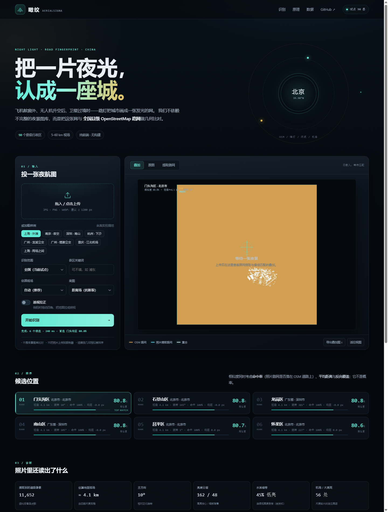

# 瞰纹 / AerialSigna

> 把一片夜光，认成一座城。
>
> 夜间航拍 / 舷窗 / 无人机 / 卫星灯光图 → 提取发光的道路网 → 与全国县级 OSM 路网指纹做几何比对 → 按相似度排序并叠加展示。

AerialSigna 是一个**纯前端、无构建、可直接部署到 GitHub Pages** 的实验性演示。它不依赖不完整的“夜景图数据库”，而是把 OpenStreetMap 的矢量路网栅格化成可快速匹配的距离场/路网图，用它来解释夜间的灯光骨架。



## 为什么是路网，不是夜景图

同一座城市，白天的卫星图、夜间的灯光图、OSM 矢量路网，三者的几何骨架是同一个东西：

- 夜景图里最稳定、最连续的特征不是建筑立面，而是**被路灯照亮的街道**；
- 路灯的亮度/颜色会随道路等级、城区/城郊、灯型变化，但**道路的走向、间距、交叉关系**不会变；
- OSM 路网覆盖全国所有县级行政区，且不依赖“这座城有没有人拍过夜景”。

因此参考端不是“另一张夜景图”，而是 OSM 路网。栅格化只是为了用 FFT 快速做平移搜索，底层数据仍然是矢量；后续可以在栅格召回后，把 OSM 折线投影回查询图做矢量支撑率/单应 refine。

## 当前能力

- **全国县级索引**：`data/counties.json` 收录 2,896 个县级行政区（DataV GeoAtlas + 台湾 22 县市补齐）。
- **指纹库**：以县级政府驻地为中心，20 km 视场，384 px 路网图 + 4 px/灰阶距离场 + 50 维旋转感知描述子。
- **浏览器内匹配**：
  - 查询图预处理：灰度 top-hat、暖色（钠灯）加权、Zhang-Suen 细化、覆盖率降采样；
  - 粗筛：方向直方图 + 径向分布 + 密度；
  - 粗排：24 个 15° 旋转 × 视场先验尺度，路网二值图与查询骨架做 NCC；
  - 精排：256 px，±8°/4°、±18% 尺度，NCC + 正向命中率 + 反向路网覆盖率 + 视场一致性；
  - 输出：相似度、估算视场、旋转角、叠加图、道路像素/主方向/亮度/水域/机场等诊断。
- **区域过滤**：全国 / 省 / 县区关键词；URL 参数 `?province=上海市&county=浦东`。
- **手动透视矫正**：拖动四角做单应变换，处理舷窗侧拍；自动消失点矫正尚未完成。
- **样例**：`samples/manifest.json`，含 Commons 真实夜景、合成对照图，均带已知位置/视场。

## 快速开始

```bash
# 任意静态服务器即可，不需要 npm / 构建
cd AerialSigna
python -m http.server 8899 --bind 127.0.0.1
# 打开 http://127.0.0.1:8899/
```

直接双击 `index.html` 通常也可以，但部分浏览器会因 `file://` 的 fetch/CORS 限制而无法读取索引，建议用本地静态服务器。

### URL 调试参数

| 参数 | 作用 |
|---|---|
| `?sample=synthetic_beijing` | 载入指定样例 |
| `?province=北京市&county=东城区` | 只保留候选县区 |
| `?view=mask&norun=1` | 只显示提取出的路网骨架，不自动匹配 |
| `?debug=1` | 控制台输出粗筛/粗排/尺度调试信息 |
| `?dumpmask=1` | 页面底部输出 mask PNG dataURL，便于离线分析 |

## 构建指纹库

### 依赖

- Python 3.9+
- `numpy`, `Pillow`
- 网络可访问 `https://tiles.openfreemap.org/planet/20250122/{z}/{x}/{y}.pbf`

不依赖 GDAL / pyosmium / protobuf / scipy。`pipeline/mvt.py` 是一个纯标准库的 MVT 读取器。

### 全国构建

```bash
python pipeline/build_national.py --all --workers 24
```

- 每 2×2 个 z11 矢量瓦片渲染成一个 2048 px 的 z9 路网 mask；
- 以每个县级驻地为中心裁 20 km，输出 `data/fp/cn/<省 adcode>/<县 adcode>_{r,d}.png` 与 `<adcode>.json`；
- 合并到 `data/fp/index.json`；
- 缓存位于 `pipeline/cache/`，可断点续跑；已存在的县不会重复生成，但会重建索引。

单省/单市调试：

```bash
python pipeline/build_national.py --province 浙江省 --workers 8
python pipeline/build_national.py --test 北京市 --limit 4 --workers 4
```

### 高分辨率试点

`pipeline/make_fingerprints.py` 用 Overpass 生成 1024 px、5/10/20/40 km 的北京市试点指纹，用于算法验证；全国索引使用上面的 MVT 管线。

## 数据格式

`data/fp/index.json`：

```json
{
  "schema": 1,
  "count": 2896,
  "counties": [
    {
      "id": "110101",
      "name": "东城区",
      "city": "北京市",
      "province": "北京市",
      "province_adcode": "110000",
      "lat": 39.928,
      "lon": 116.416,
      "fov_km": 20,
      "px": 384,
      "roads_px": 12345,
      "desc": [/* 36 orientation + 12 radial + density + log count */]
    }
  ]
}
```

瓦片：

- `_r.png`：白路网 / 黑底，384×384；
- `_d.png`：距离场，灰度值 × 4 = 像素距离（384 px 下）；
- `<adcode>.json`：单县元数据，字段同上。

## 算法管线

```
查询图
  ├─ 灰度/暖色加权 top-hat
  ├─ Zhang-Suen 细化 → 256 px 骨架
  ├─ 50 维描述子 → 方向/径向预筛
  ├─ 粗排：24 角度 × FOV 先验尺度，NCC（路网二值图 vs 骨架）
  └─ 精排：±8°/4°、±18% 尺度，NCC + hit + reverse + FOV penalty
        └─ 结果：相似度 / 视场 / 角度 / 平移 / 叠加
```

关键设计：

- **不用 chamfer 单独排序**：网格城市在错误尺度/180° 旋转下 chamfer 也会接近 0（放大后更多道路落在参考路网上），会系统性偏向“过度放大”的解。改用路网二值图的归一化互相关，并加反向覆盖率。
- **视场先验**：样本/EXIF 有 FOV 时，粗排固定 `FOV/20` 尺度，精排只 ±18%；没有先验才搜索 0.25–2.0。
- **反向覆盖率**：参考路网落在查询 footprint 内的部分也应被灯光骨架支持，否则密集网格会“解释一切”。

## 评估现状

详见 [docs/EVALUATION.md](docs/EVALUATION.md)。

| 用例 | 结果 | 状态 |
|---|---|---|
| 北京 10 km 合成图，未旋转，全国 2,896 县 | 西城 80.0%、东城 77.9%、朝阳 68.7%，前三正确 | ✅ |
| 北京 10 km 合成图，旋转 18° | 单县东城 72.4%、角度 19° | ✅（单县） |
| 北京 10 km 合成图，旋转 18°，全国 2,896 县 | 角度 20°、视场 10.4 km 接近真值，但鄞州误排第一 | ⚠️ 旋转描述子粗排丢失北京 |
| 上海外滩真实舷窗侧拍 | 尚未得到可用骨架（建筑光斑/反光） | ⚠️ 需透视矫正 + 更强线段提取 |

## 已知限制

1. **真实斜拍**：舷窗玻璃反光、建筑立面、雾霾会污染 top-hat；目前手动四角矫正可用，自动消失点/地平线检测未完成。
2. **网格城市旋转歧义**：北京、深圳等正交路网在 180° 旋转和 ±20% 尺度下高度自相似；需要相位一致性、线段图匹配或更强的角度先验。
3. **道路等级 vs 亮度**：当前只做了“暖色 + 线状”筛选，尚未显式学习“这条路晚上有没有灯”的概率模型。
4. **全国索引分辨率**：全国瓦片为 20 km / 384 px（约 52 m/px），适合粗筛；大城市的高清 1024 px 指纹仍以 40 个试点城市为主。
5. **台湾**：DataV 未返回县级 feature；已用 `pipeline/add_taiwan.py` 补齐 22 个县市，共 2,896 个县级单元。

## 目录

```
AerialSigna/
├─ index.html                  # 单页 demo
├─ assets/css/app.css
├─ assets/js/
│  ├─ app.js                   # UI / 上传 / 矫正 / 叠加
│  ├─ preprocess.js            # 骨架提取与描述子
│  ├─ matcher.js               # 预筛 + 粗排 + 精排
│  └─ fft.js                   # radix-2 FFT / correlation
├─ data/
│  ├─ counties.json            # 2,896 县级行政区
│  ├─ cities.json              # 40 个高清试点城市
│  └─ fp/                      # 指纹库与 index.json
├─ pipeline/
│  ├─ build_national.py        # MVT → 全国县级瓦片
│  ├─ make_fingerprints.py     # Overpass → 高清试点
│  ├─ mvt.py                   # 纯标准库 MVT reader
│  └─ fetch_counties.py        # DataV 行政区抓取
├─ samples/                    # 真实/合成样例 + manifest
├─ docs/                       # 评估、数据说明、截图
└─ tools/harvest_commons.py    # Commons 样例采集
```

## 数据与许可

- 路网：© OpenStreetMap contributors，ODbL；矢量瓦片来自 [OpenFreeMap](https://openfreemap.org/)。
- 行政区划：DataV GeoAtlas（阿里云），仅用于研究/演示。
- 样例图片：Wikimedia Commons，遵循各自 CC 许可；`samples/manifest.json` 记录作者与许可。
- 代码：MIT（见 [LICENSE](LICENSE)）。

## 致谢 / 参考

- IBM `cities-from-space`（已归档）与 ESA/NASA **Cities at Night**：证明了“夜间城市灯光图案可作为城市指纹”。
- MDPI *Georeferencing Urban Nighttime Lights Imagery Using Street Network Maps*：OSM 路网栅格化 + 特征匹配的思路。
- `tsooryakie/ISS-image-city-classifier`、`IS2AI/city-identification`：夜间/白天城市分类的工程参考。

本项目与上述项目无隶属关系；差异点是**参考端使用全国县级 OSM 路网，而不是夜景图库**，并把匹配放在浏览器内完成。
